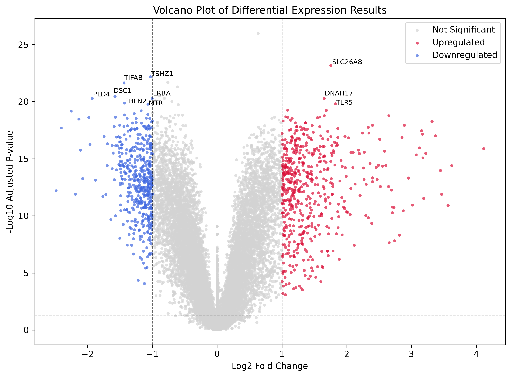
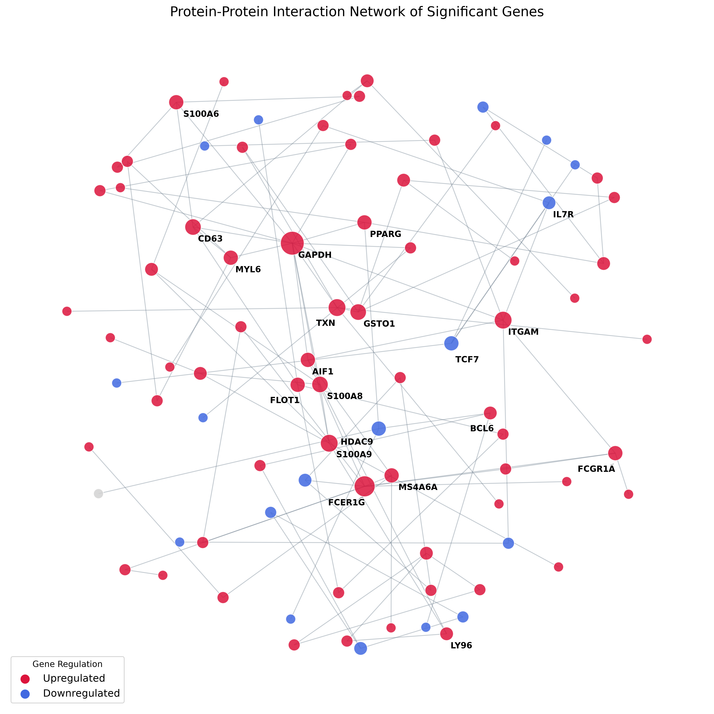
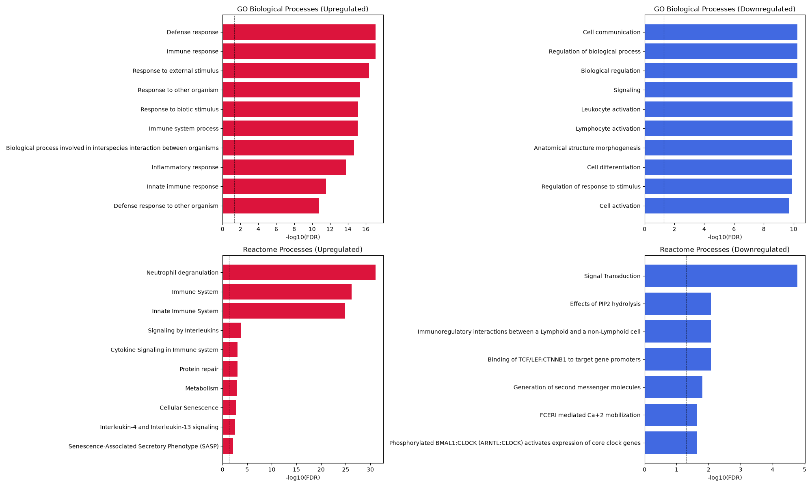

# Sepsis Transcriptome & Protein-Protein Interaction Network Analysis

A modular Python bioinformatics pipeline for differential gene expression, protein-protein interaction (PPI) network topology, and functional pathway enrichment analysis in human sepsis whole-blood bulk RNA-seq data (**NCBI GEO: GSE154918**).

---

## Overview & Biological Motivation

Sepsis is characterized by a dysregulated host response to infection involving simultaneous hyperinflammation and adaptive immune suppression. Using the **GSE154918** transcriptomic dataset (Sepsis patients vs. Healthy controls), this pipeline:

1. Identifies significantly differentially expressed genes (DEGs) between sepsis and healthy control samples.
2. Reconstructs a high-confidence functional PPI network via the **STRING** database and ranks topological hub genes using graph centrality metrics.
3. Performs over-representation analysis across **Gene Ontology (GO) Biological Processes** and **Reactome Pathways** to link transcriptional shifts to immunological mechanisms.

---

## Pipeline Architecture

| Step | Script | Methodology & Parameters | Primary Outputs |
| :--- | :--- | :--- | :--- |
| **1. Data Ingestion** | `src/01_fetch_data.py` | Downloads and parses GSE154918 expression matrix and sample metadata; filters low-expression genes and aligns sample identifiers. | Processed expression & metadata tables in `data/` |
| **2. Differential Expression** | `src/02_diff_expression.py` | Welch's two-sample *t*-test with Benjamini–Hochberg FDR correction (FDR < 0.05, \|log2FC\| > 1). | `results/tables/GSE154918_differential_expression_results.csv` |
| **3. DEG Visualization** | `src/03_visualize_de.py` | Volcano plot highlighting upregulated and downregulated genes with collision-free label placement via `adjustText`. | `results/figures/GSE154918_volcano_plot.png` |
| **4. PPI Network & Hubs** | `src/04_ppi_network.py` | Queries STRING REST API (`required_score >= 700`) for top 400 DEGs; extracts the Largest Connected Component (84 nodes, 104 edges) and computes Degree, Betweenness, and Eigenvector centralities. | `results/tables/GSE154918_ppi_network_hub_genes.csv`<br>`results/figures/GSE154918_ppi_network.png` |
| **5. Functional Enrichment** | `src/05_functional_enrichment.py` | Queries STRING Enrichment API (FDR < 0.05) separately for top 400 upregulated and downregulated DEGs across GO Biological Process (`Process`) and Reactome (`RCTM`). | `results/tables/GSE154918_functional_enrichment_results.csv`<br>`results/figures/GSE154918_functional_enrichment_plot.png` |

---

## Key Results & Biological Interpretation

### 1. Differential Gene Expression


* **Transcriptional Reprogramming:** Sepsis induces widespread upregulation of innate immune effectors alongside pronounced suppression of lymphocyte-associated transcripts.

### 2. Protein-Protein Interaction Network & Hub Genes


* **Upregulated Inflammatory & Metabolic Hubs:** Central nodes with high degree and betweenness centrality include **`GAPDH`**, **`ITGAM`**, **`FCER1G`**, **`S100A8`**, **`S100A9`**, **`BCL6`**, and **`TXN`**, reflecting neutrophil activation, innate immune signaling, oxidative stress response, and glycolytic metabolic reprogramming.
* **Downregulated Adaptive Immunity Hubs:** **`TCF7`**, **`IL7R`**, and **`HDAC9`** emerge as key downregulated hubs, pointing toward T-cell exhaustion and impaired lymphoid homeostasis during sepsis.

### 3. Functional & Pathway Enrichment


* **Hyperinflammation & Innate Activation (Upregulated):** Top enriched terms include *Neutrophil degranulation* (FDR = 8.64e-32), *Innate Immune System* (FDR = 1.25e-25), *Defense response* (FDR = 8.21e-18), and *Inflammatory response* (FDR = 1.58e-14).
* **Lymphocyte Suppression & Wnt/TCF Signaling Loss (Downregulated):** Significantly downregulated processes include *Lymphocyte activation* (FDR = 1.17e-10), *Leukocyte activation* (FDR = 1.17e-10), and *Binding of TCF/LEF:CTNNB1 to target gene promoters* (FDR = 0.0084), directly corroborating the downregulation of hub gene `TCF7` in the PPI network.

---

## Repository Structure

```text
sepsis-transcriptome-network/
├── data/                                                  # Raw and processed GEO input data (git-ignored)
├── results/
│   ├── figures/
│   │   ├── GSE154918_volcano_plot.png                     # Differential expression volcano plot
│   │   ├── GSE154918_ppi_network.png                      # STRING PPI network with top 20 hub labels
│   │   └── GSE154918_functional_enrichment_plot.png       # 2x2 GO & Reactome enrichment overview
│   └── tables/
│       ├── GSE154918_differential_expression_results.csv  # Full Welch's t-test & BH-FDR statistics
│       ├── GSE154918_ppi_network_hub_genes.csv            # Node centrality metrics & regulation status
│       └── GSE154918_functional_enrichment_results.csv    # Significant GO & Reactome terms (FDR < 0.05)
├── src/
│   ├── __init__.py
│   ├── 01_fetch_data.py
│   ├── 02_diff_expression.py
│   ├── 03_visualize_de.py
│   ├── 04_ppi_network.py
│   └── 05_functional_enrichment.py
├── .gitignore
├── requirements.txt
└── README.md
```

---

## Installation & Usage

### 1. Clone the repository & set up environment
```bash
git clone https://github.com/maaax04/sepsis-transcriptome-network.git
cd sepsis-transcriptome-network
python -m venv .venv
source .venv/bin/activate
pip install -r requirements.txt
```

### 2. Run the pipeline sequentially
```bash
python src/01_fetch_data.py
python src/02_diff_expression.py
python src/03_visualize_de.py
python src/04_ppi_network.py
python src/05_functional_enrichment.py
```

---

## Tech Stack
* **Data Processing & Statistics:** `pandas`, `numpy`, `scipy`, `statsmodels`
* **Network Analysis & APIs:** `networkx`, `requests` (STRING REST API v12)
* **Visualization:** `matplotlib`, `adjustText`